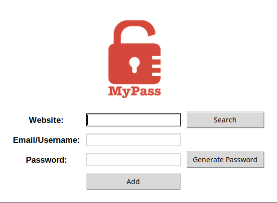

# Tkinter-Password-Manager

A basic Password Manager using Tkinter for its Graphical User Interface

> [!WARNING]
> This program is a **Proof Of Concept** & should not be used for everyday use due to its lack of **Security & Encryption**

## How It Works
- Adding information automatically creates & saves to a file named **IGNORE** in project root 
- Searching for a **Website** returns the **Username & Password** associated with it
- **Generate Password** returns a random 42 length password for saving
- **Add** saves all input field information to file & updates any existing **Website** credentials
- Credentials are saved using **JSON** format

## Examples

## Inspiration
This project is **Day 29 - Day 30** in the _[100 Days of Code: The Complete Python Pro Bootcamp](https://www.udemy.com/course/100-days-of-code/?couponCode=MT261019G2)_
